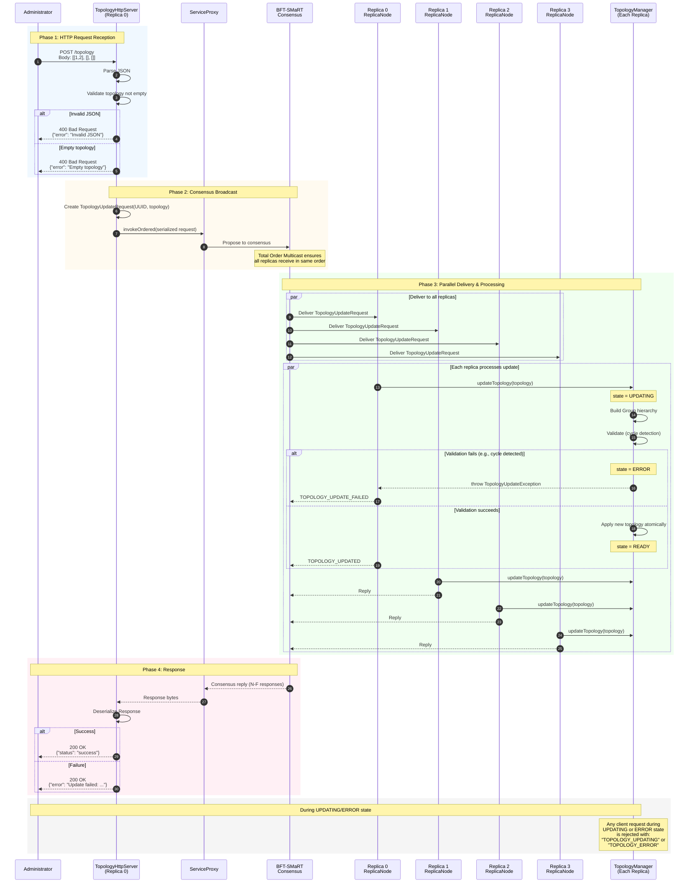

# Dynamic Topology Update Architecture

This document describes the architecture for the dynamic topology update feature in the ByzCast system.

## Overview

The dynamic topology update feature enables runtime reconfiguration of the ByzCast system's hierarchical group topology via an HTTP endpoint, with updates propagated through BFT-SMaRT consensus.

### Key Characteristics

- **Consensus-Driven**: Updates propagated through BFT-SMaRT total order multicast
- **Single Entry Point**: One designated replica hosts the HTTP endpoint
- **Request Rejection**: In-flight requests rejected during topology transitions
- **Atomic Updates**: Topology changes applied atomically using `AtomicReference`

---

## System Architecture

```
┌─────────────────────────────────────────────────────────────────────────────────┐
│                                  ByzCast System                                  │
├─────────────────────────────────────────────────────────────────────────────────┤
│                                                                                  │
│   ┌─────────────────────────────────────────────────────────────────────────┐   │
│   │                           ByzCast Cluster                                │   │
│   │                                                                          │   │
│   │   ┌─────────────────┐  ┌─────────────┐  ┌─────────────┐  ┌───────────┐  │   │
│   │   │   Replica 0     │  │  Replica 1  │  │  Replica 2  │  │ Replica 3 │  │   │
│   │   │                 │  │             │  │             │  │           │  │   │
│   │   │ ┌─────────────┐ │  │             │  │             │  │           │  │   │
│   │   │ │ HTTP Server │ │  │             │  │             │  │           │  │   │
│   │   │ │ (Jetty)     │ │  │             │  │             │  │           │  │   │
│   │   │ │ POST /topo  │ │  │             │  │             │  │           │  │   │
│   │   │ └──────┬──────┘ │  │             │  │             │  │           │  │   │
│   │   │        │        │  │             │  │             │  │           │  │   │
│   │   │ ┌──────▼──────┐ │  │ ┌─────────┐ │  │ ┌─────────┐ │  │ ┌───────┐ │  │   │
│   │   │ │ Replica     │ │  │ │ Replica │ │  │ │ Replica │ │  │ │Replica│ │  │   │
│   │   │ │ Node        │ │  │ │ Node    │ │  │ │ Node    │ │  │ │Node   │ │  │   │
│   │   │ └──────┬──────┘ │  │ └────┬────┘ │  │ └────┬────┘ │  │ └───┬───┘ │  │   │
│   │   │        │        │  │      │      │  │      │      │  │     │     │  │   │
│   │   │ ┌──────▼──────┐ │  │ ┌────▼────┐ │  │ ┌────▼────┐ │  │ ┌───▼───┐ │  │   │
│   │   │ │ Topology    │ │  │ │Topology │ │  │ │Topology │ │  │ │Topo   │ │  │   │
│   │   │ │ Manager     │ │  │ │Manager  │ │  │ │Manager  │ │  │ │Manager│ │  │   │
│   │   │ └─────────────┘ │  │ └─────────┘ │  │ └─────────┘ │  │ └───────┘ │  │   │
│   │   └────────┬────────┘  └──────┬──────┘  └──────┬──────┘  └─────┬─────┘  │   │
│   │            │                  │                │               │        │   │
│   │            └──────────────────┼────────────────┼───────────────┘        │   │
│   │                               │                │                        │   │
│   │                    ┌──────────▼────────────────▼──────────┐             │   │
│   │                    │         BFT-SMaRT Consensus          │             │   │
│   │                    │    (Total Order Multicast Layer)     │             │   │
│   │                    └──────────────────────────────────────┘             │   │
│   │                                                                          │   │
│   └──────────────────────────────────────────────────────────────────────────┘   │
│                                                                                  │
└─────────────────────────────────────────────────────────────────────────────────┘
        ▲                           ▲                           ▲
        │                           │                           │
        │ HTTP POST                 │ Requests                  │ Requests
        │ /topology                 │                           │
        │                           │                           │
   ┌────┴────┐                 ┌────┴────┐                 ┌────┴────┐
   │  Admin  │                 │ Client  │                 │ Client  │
   └─────────┘                 └─────────┘                 └─────────┘
```

---

## Complete Flow Sequence Diagram



---

## State Machine

```
                    ┌─────────────────────────────────────────┐
                    │            TopologyState                │
                    └─────────────────────────────────────────┘

                              ┌─────────┐
                              │  READY  │◄──────────────────────┐
                              └────┬────┘                       │
                                   │                            │
                        updateTopology()                        │
                             called                             │
                                   │                            │
                                   ▼                            │
                            ┌──────────┐                        │
                            │ UPDATING │                        │
                            └────┬─────┘                        │
                                 │                              │
                    ┌────────────┴────────────┐                 │
                    │                         │                 │
               Success                    Failure               │
                    │                         │                 │
                    ▼                         ▼                 │
              ┌─────────┐              ┌──────────┐             │
              │  READY  │              │  ERROR   │─────────────┘
              └─────────┘              └────┬─────┘
                                            │
                                   acknowledgeError()
                                         called
                                            │
                                            ▼
                                      ┌─────────┐
                                      │  READY  │
                                      └─────────┘

    ┌─────────┬───────────────────────────────┬─────────────────────────┐
    │  State  │  Description                  │  Request Handling       │
    ├─────────┼───────────────────────────────┼─────────────────────────┤
    │  READY  │  Normal operation             │  Process normally       │
    │ UPDATING│  Update in progress           │  Reject: TOPOLOGY_UPDATING │
    │  ERROR  │  Last update failed           │  Reject: TOPOLOGY_ERROR │
    └─────────┴───────────────────────────────┴─────────────────────────┘
```

---

## Key Components

| Component | Purpose |
|-----------|---------|
| **TopologyHttpServer** | Embedded Jetty server, exposes POST `/topology` endpoint |
| **TopologyUpdateRequest** | Message record with UUID and topology list for BFT-SMaRT |
| **TopologyManager** | Thread-safe topology holder with state machine |
| **TopologyState** | Enum: READY, UPDATING, ERROR |
| **ReplicaNode** | Deserializes messages, dispatches to handler or topology update |
| **RequestHandler** | Checks state before processing, rejects if not READY |

---

## Advantages

1. **Consistency** - BFT-SMaRT ensures all replicas update in same order
2. **Zero Downtime** - No restart required for topology changes
3. **Byzantine Fault Tolerant** - Up to F faulty replicas tolerated (N = 3F + 1)
4. **Simple API** - Single HTTP endpoint with JSON payload
5. **Atomic Updates** - All-or-nothing application via AtomicReference
6. **Validation** - Cycle detection prevents invalid topologies

## Disadvantages

1. **Request Rejection** - Clients get errors during updates (must retry)
2. **Single Entry Point** - Only one replica has HTTP endpoint
3. **No Rollback** - Failed updates require manual intervention
4. **Synchronous** - HTTP blocks until consensus completes

---

## Usage

```bash
# Update topology
curl -X POST http://localhost:9080/topology \
  -H "Content-Type: application/json" \
  -d '[[1, 2], [], []]'

# Response (success)
{"status": "success", "message": "Topology updated successfully"}

# Response (error)
{"error": "Topology update failed: Group 0 attempted to have ancestor 0 as child"}
```

### JSON Topology Format

```
Index = Group ID
Value = Array of child group IDs

Example: [[1, 2], [3], [], []]

    Group 0 (root)
       /    \
   Group 1  Group 2
      |
   Group 3
```
