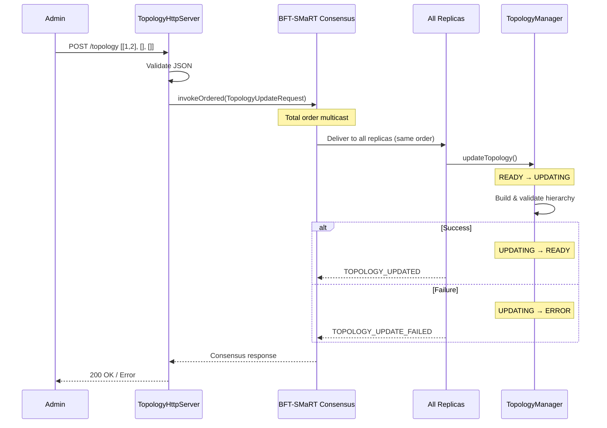

# Dynamic Topology Update Architecture

Runtime reconfiguration of the ByzCast hierarchical group topology via HTTP, with updates propagated through BFT-SMaRT consensus.

## Design Decisions

| Decision | Rationale |
|----------|-----------|
| **Single HTTP entry point** | One replica (operator-chosen via `--http-port`) receives updates, avoiding coordination complexity |
| **Consensus-backed propagation** | BFT-SMaRT total order multicast ensures all correct replicas apply updates in the same order |
| **Request rejection during updates** | Prevents routing with stale/inconsistent topology; clients must retry |
| **Atomic state transitions** | `AtomicReference<Topology>` and `AtomicReference<TopologyState>` for thread-safe updates |
| **Shared validation path** | `TopologyLoader.buildFromList(...)` used by both file loading and runtime updates |

## Components

| Component | Responsibility |
|-----------|----------------|
| `TopologyHttpServer` | Embedded Jetty server exposing `POST /topology` |
| `TopologyUpdateRequest` | Serializable record (UUID + topology list) for BFT-SMaRT |
| `TopologyManager` | Thread-safe topology holder with state machine (READY → UPDATING → READY/ERROR) |
| `ReplicaNode` | Deserializes messages, routes to handler or topology update logic |
| `RequestHandler` | Gates requests based on `TopologyState`, rejects if not READY |

## Update Flow



## State Machine

- **READY**: Normal operation, requests processed
- **UPDATING**: Update in progress, requests rejected with `TOPOLOGY_UPDATING`
- **ERROR**: Last update failed, requests rejected with `TOPOLOGY_ERROR` (reset via `acknowledgeError()`)

## Usage

```bash
curl -X POST http://localhost:9080/topology \
  -H "Content-Type: application/json" \
  -d '[[1, 2], [], []]'
```

Topology format: index = group ID, value = array of child group IDs.

## Trade-offs

| Advantage | Disadvantage |
|-----------|--------------|
| Consistent updates across replicas | Requests rejected during transitions |
| Zero downtime reconfiguration | Single entry point (no HA for HTTP) |
| BFT guarantees (tolerates F faults) | Synchronous (HTTP blocks on consensus) |
| Simple JSON API | No automatic rollback on failure |
